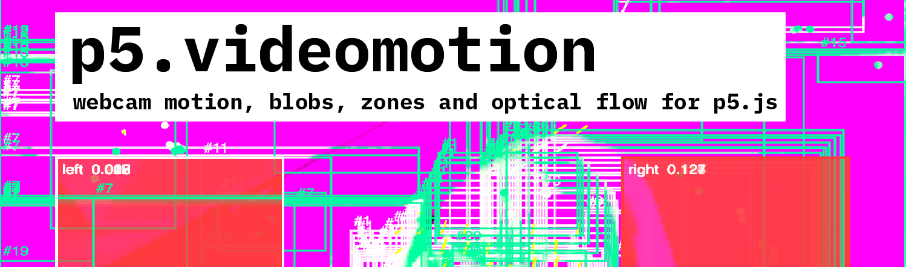

# p5.videomotion



### Webcam & motion tracking for p5.js 2.x

## 📖 [Documentation & live examples → bmoren.github.io/p5.videomotion](https://bmoren.github.io/p5.videomotion/)

p5.videomotion turns a webcam (or any video, image or `p5.Graphics`) into motion data you can use in a sketch:

- **Motion mask:** which pixels changed, using an adaptive, static or frame-difference background
- **Blobs:** connected regions of motion, tracked frame to frame with stable ids, hulls, centres and velocity
- **Zones:** rectangles that report how much motion is inside them, with `onEnter` / `onExit` events
- **Optical flow:** Lucas–Kanade flow vectors for direction and speed of movement

The API follows p5 conventions, and the library is 3–5× faster than p5.vida, which inspired it. It is built for p5.js 2.x and also runs on 1.x.

[Overview](https://bmoren.github.io/p5.videomotion/) · [API Reference](https://bmoren.github.io/p5.videomotion/reference.html) · [Examples](https://bmoren.github.io/p5.videomotion/examples.html)

## Get started

### CDN

Load p5.videomotion **after** p5.js:

```html
<script src="https://cdn.jsdelivr.net/npm/p5@2/lib/p5.min.js"></script>
<script src="https://cdn.jsdelivr.net/gh/bmoren/p5.videomotion/p5.videomotion.js"></script>
<script src="sketch.js"></script>
```

Other CDN links:

- jsDelivr: `https://cdn.jsdelivr.net/gh/bmoren/p5.videomotion/p5.videomotion.js`
- unpkg: `https://unpkg.com/p5.videomotion/p5.videomotion.js`

To pin a version, add a tag, for example `.../gh/bmoren/p5.videomotion@0.1.0/p5.videomotion.js`.

### Download

Download [`p5.videomotion.js`](p5.videomotion.js) and include it with a `<script>` tag after p5.js. In the [p5.js Web Editor](https://editor.p5js.org), upload the file to your sketch, or paste the CDN line into `index.html`.

### Basic example

```js
let cam, motion;

function setup() {
  createCanvas(640, 480);
  cam = createCapture(VIDEO, { flipped: true });
  cam.hide();
  motion = createMotion(cam);
  motion.zone('left', 40, 140, 160, 200).onEnter(z => console.log('hi'));
}

function draw() {
  image(cam, 0, 0, width, height);
  motion.debug();
}
```

> **Camera access needs `https://` or `http://localhost`.** Opening an HTML file straight from disk won't work. Run a small local server such as `npx serve` or `python3 -m http.server 8000`. See [Installation](https://bmoren.github.io/p5.videomotion/#installation).

## Live examples

Each example runs in the browser and asks for your camera.

#### Basics
- [Starter](https://bmoren.github.io/p5.videomotion/examples/starter/): webcam, adaptive background, two zones and the debug overlay
- [Without a camera](https://bmoren.github.io/p5.videomotion/examples/no-camera/): a moving `p5.Graphics` as the source
- [Instance mode](https://bmoren.github.io/p5.videomotion/examples/instance-mode/): the starter in p5 instance mode
- [Camera in part of the canvas](https://bmoren.github.io/p5.videomotion/examples/map-to/): `mapTo()` keeps zones and blobs lined up with a smaller frame

#### Zones
- [Zone pads](https://bmoren.github.io/p5.videomotion/examples/zone-pads/): four zones that work as buttons
- [Zone meter and threshold](https://bmoren.github.io/p5.videomotion/examples/zone-meter/): a live meter of a zone's amount against its threshold
- [Direction inside zones](https://bmoren.github.io/p5.videomotion/examples/zone-flow/): a grid of zones showing average movement direction

#### Blobs
- [Drawing blobs](https://bmoren.github.io/p5.videomotion/examples/blobs/): hulls, centres, ids and velocity drawn by hand
- [Blob trails and events](https://bmoren.github.io/p5.videomotion/examples/blob-trails/): per-blob trails using `onBlobEnter` / `onBlobExit`

#### Optical flow
- [Flow field](https://bmoren.github.io/p5.videomotion/examples/flow-field/): every flow vector, coloured by direction
- [Flow particles](https://bmoren.github.io/p5.videomotion/examples/flow-particles/): 1,500 particles pushed around by `flowAt()`
- [Swipe gestures](https://bmoren.github.io/p5.videomotion/examples/swipe/): left, right, up and down swipes from `averageFlow()`

#### Background and mask
- [Background modes](https://bmoren.github.io/p5.videomotion/examples/background-modes/): switch between adaptive, static and frame backgrounds
- [Mask ghosts](https://bmoren.github.io/p5.videomotion/examples/mask-ghosts/): the motion mask as an image that leaves ghost trails

#### Performance
- [Resolution and manual updates](https://bmoren.github.io/p5.videomotion/examples/resolution/): time `update()` and change the processing resolution

## Documentation

- [Overview & guide](https://bmoren.github.io/p5.videomotion/): concepts, tuning, troubleshooting, and [migrating from p5.vida](https://bmoren.github.io/p5.videomotion/#migrating-from-p5-vida)
- [API reference](https://bmoren.github.io/p5.videomotion/reference.html): every function, property and event

## License

MIT. Inspired by [p5.vida](http://tetoki.eu/vida) by Paweł Janicki.
